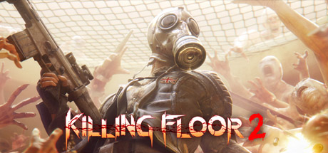

# Killing Floor 2



## Ports

* **Game Port** Default: 7777 UDP Handled by: `LinuxServer-KFEngine.ini`&#x20;
* **Query Port** Default: 27015 UDP Handled automatically or handled by parameters. The formula for finding query port assigned automatically is 19238 + assigned game port.&#x20;
* **Web Admin** Default: 8080 TCP Handled by: `KFWeb.ini`&#x20;
* **Steam Port** Default: 20560 UDP Handled automatically. The formula for finding the steam port is 12783 + Game Port.

## Resources

[Killing Floor 2 Official Server Wiki](https://wiki.tripwireinteractive.com/index.php?title=Dedicated\_Server\_%28Killing\_Floor\_2%29)

[Killing floor 2 Official Forums](https://forums.tripwireinteractive.com/index.php?categories/killing-floor-2.25/)

## Server Config Information

LinuxGSM installations contain `configSubDir=servername` in the command line by default, which creates a folder for config files named after the server. The default directory is `/home/user/serverfiles/KFGame/Config/kf2server` . Use these files to change server settings.

## Workshop


Players on the Epic Store will not be able to download files hosted with the Steam Workshop.


Workshop content is added in `LinuxServer-KFEngine.ini` in the `OnlineSubsystemSteamworks.KFWorkshopSteamworks` section


Ensure the game server is stopped before editing the file to prevent it being overwritten.


```
KFGame/Config/kf2server/LinuxGSM-KFEngine.ini
```

```
[OnlineSubsystemSteamworks.KFWorkshopSteamworks]
ServerSubscribedWorkshopItems=605633924
ServerSubscribedWorkshopItems=605551918
ServerSubscribedWorkshopItems=605549089
ServerSubscribedWorkshopItems=605532351
```

This will only work for Workshop items that the server downloads itself, that are listed in the \[OnlineSubsystemSteamworks.KFWorkshopSteamworks] section as described above.

1. Make sure that the server is not running. If it is running, the Workshop setup will be overridden the next time you restart the server.
2. Find the section \[IpDrv.TcpNetDriver] in the PCServerEngine.ini config file.
3. Add the line "DownloadManagers=OnlineSubsystemSteamworks.SteamWorkshopDownload" to that section. If there are other "DownloadManagers=" lines, make sure this one is the first.
4. Do not delete anything from this section, except (optionally) other DownloadManagers= lines.

[Official Guide Here](https://wiki.killingfloor2.com/index.php?title=Dedicated\_Server\_\(Killing\_Floor\_2\)#Setting\_Up\_Steam\_Workshop\_For\_Servers)

### Workshop maps as the starting map


Do not set a Workshop map as the starting map until the server has downloaded it. If the map is not downloaded yet, the server aborts at `LoadMap` and fails to start.


Start the server on a stock map first, such as the default `KF-BioticsLab`, so it can download the Workshop items listed in `ServerSubscribedWorkshopItems`. Once the download has finished, the Workshop map can be used as the starting map by setting `defaultmap` in the LinuxGSM config.
