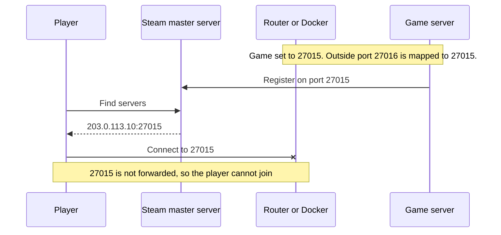
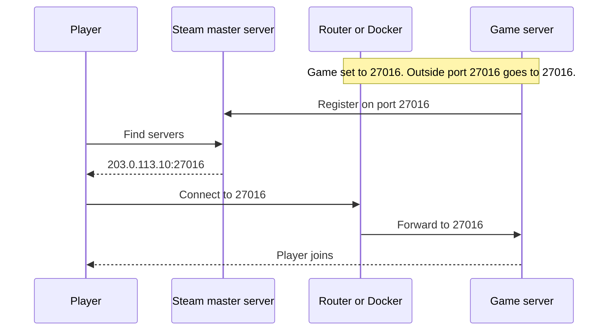

# Ports

Ports are communication endpoints for an application. A port will either listen to or transmit network traffic on specific ports.&#x20;

There are port standards set by IANA for common protocols such as HTTP (port 80), SSH (port 22), SMTP (port 25), etc. Game servers tend to use standard ports depending on the game engine. For example source engine games by default use port 27015 as the port it listens on.

## Vocabulary

* _**Port listening**_ is what a service like a game server does in order to receive packets from incoming connections: by listening to a port, the program waits for incoming packets on a given port.
* _**Port opening**_ happens on a firewall, it consists of allowing traffic to a port.
* _**Port redirection**_ is part of NAT and happens on a router or firewall. It consists of forwarding incoming traffic on a given port to a specific local IP.
* _**Network Address Translation (NAT)**_  is a method of remapping an IP address into another by modifying [network address](https://en.wikipedia.org/wiki/Network\_address) information.

## Game Server Ports

Game Servers typically have ports for the following functions.

Game port: The port that players connect to.\
Query port: Used by software to gather information from the server such as server name, map, and number of players.\
Rcon port: Some game servers have remote console port allowing remote administration of a game server. \
Web port: used for game servers that have web interface.

Depending upon which game server is being used, you can set game server ports within your [start parameters](../configuration/start-parameters.md) or [game server](../configuration/game-server-config.md) config file.

LinuxGSM allows you to see the ports your game server is using with the `./gameserver details` command.

```
Useful port diagnostic command:
ss -tuplwn | grep RustDedicated

DESCRIPTION  PORT   PROTOCOL  LISTEN
Game         28015  udp       1
Query        28017  udp       1
RCON         28016  tcp       1
App          28082  tcp       1
```

## Changing Default Ports

Default ports are set in either the [start parameters](../configuration/start-parameters.md) or [game config](../configuration/game-server-config.md).&#x20;

You can use `./gameserver details` to find out where to edit port settings

```
# Ports
# =====================================
# Change ports by editing the parameters in:
# /home/lgsm/qlserver/serverfiles/baseq3/ql-server.cfg
```

To alter them you will need to edit the file using `nano`.

Example: for source games, you need to alter the following:

```bash
# Start Variables
port="27015"
sourcetvport="27020"
clientport="27005"
ip="0.0.0.0"
```

### Which ports can be used?

You can use any port as long as it is not already in use and it is up to you to set up port allocation. It is recommended that ports are close together and sequential i.e. 27015, 27016, 27017 to save confusion. Some server's ports by default are not sequential, however, there is nothing stopping you from changing this. For example for source engine game servers; you could set port 27015, source TV port 27016, client port 27018. The next game server instance could simply follow on from this.


If you're running multiple game servers, make sure you're using different ports on all of your game servers to avoid a port conflict.


## Multiple IP addresses

Should a server have multiple dedicated IP addresses allocated, it is possible for game servers to have the same ports but bound to different IP addresses. Admins will need to set the specific IP address in the LinuxGSM config or game config.

## Static Port Mapping (NAT and Docker)

Many game servers add themselves to a server list, such as the Steam master server, and players join from that list. The game server reports the port it is configured to use, not the port the outside world sees. If Docker or a router maps a different outside port to it, the list shows the wrong port and players cannot join from the server browser.

Keep the outside port the same as the port the game is configured to use:

* **Docker:** publish the same port on both sides, for example `-p 27016:27016/udp` or `- "27016:27016/udp"` in `docker-compose.yml`, not `27016:27015/udp`.
* **Router:** forward outside port 27016 to port 27016 on the server.
* **Changing the port:** change it in the game's [start parameters](../configuration/start-parameters.md) or [game config](../configuration/game-server-config.md) first, then use the same number in Docker and on the router.

This applies to any game that registers with a server list, including Source, GoldSrc and most other Steam games. A mapped port can work for players who join by typing the address and port, but keeping the ports the same avoids the problem entirely.

### Example: a Source server on port 27016

Mapping outside port 27016 to a game still set to 27015 fails, because the server list hands players port 27015:



Setting the game itself to 27016 and passing 27016 straight through works, because the listed port is the one that is forwarded:



## Port Allocation Scheme

Each type of server has a default set of ports. This is fine to use if only one server is being set up. However, if multiple servers are being used a port scheme needs to be considered. There is no requirement to stick to specific ports but it is recommended they are in a logical order.

Source Default Ports

```
port="27015"
sourcetvport="27020"
clientport="27005"
```

### Incremental (recommended)

You can allocate ports incrementally, one after the other. With each server following on from the last.

```
port="27015"
sourcetvport="27016"
clientport="27017"
```

This scheme is the simplest option to avoid confusion when managing ports. Plus this is the most efficient scheme for reducing unused ports.

### Standard Port Increment

This method increments each type of port keeping the scheme closer to the default. It is not as efficient but keeps ports more "standard".

```bash
port="27016"
sourcetvport="27021"
clientport="27006"
```

Then increment those ports by 1 for every new server. 25 servers are using 75 ports. After making 25 servers, if you need more it is a good idea to add +100 to this 27000 range.

```bash
port="27125"
sourcetvport="27150"
clientport="27100"
```

### Separate IP Addresses

You can get new IP addresses for your dedicated server, and assign each server a new IP. This scheme is quite inefficient.

## Track your ports

If you are running several game servers it is a good idea to create a spreadsheet of the ports you have used. Allowing you to keep track of what you have already used.

## Diagnosing server accessibility

`Status: STARTED` in `./gameserver details` means LinuxGSM's tmux session exists. Use the checks below to confirm that the game has bound its ports and is accessible to players.

### Check ports are bound

Ensure the game server ports are bound and listening before anything else. You can check if your server is actually listening by using `./gameserver details` if a port is bound and listening then the `LISTEN` column will not be zero.


Depending on the game server not all ports will listen. However, a good rule is that the game and query ports will typically listen.&#x20;


```
Useful port diagnostic command:
ss -tuplwn | grep RustDedicated

DESCRIPTION  PORT   PROTOCOL  LISTEN
Game         28015  udp       0
Query        28017  udp       0
RCON         28016  tcp       0
App          28082  tcp       0
```

Running the `ss` command will bring up any ports that are listening. If not, the game server has not started or not correctly binding to its allocated ports.&#x20;

* Check that ports are not already in use by another application.
* Check that you are trying to listen to an actual interface IP.
* Check that the server does not crash upon start by checking console logs or try starting the server with `./gameserver debug`

### Check the Firewall

[Firewalls](../linux/firewalls.md) are a regular source of connectivity issues. When diagnosing connection issues temporarily disabling a firewall will help identify if it is the source of the problem.

For cloud-hosted servers, also check the provider's inbound firewall rules, such as AWS security groups. For Docker bridge networking, publish the required incoming ports with the correct TCP or UDP protocol.

### Check Port Forwarding (Local Networks)

Ensure that the router correctly redirects incoming traffic to the correct ports and local IP displayed with `./gameserver details` with the correct protocol (TCP and/or UDP).


### Check public access

Use [ismygameserver.online](https://ismygameserver.online) to check whether a supported game server responds over the Internet. Select the game and enter its public IP address or hostname and query port. For supported games, `./gameserver details` provides a `Query Check` link with the server address already filled in. A failed query can have several causes, including server startup, an incorrect address or port, or network filtering.

Test player access by connecting with a game client from outside the server's local network. Local `LISTEN` entries show bound sockets; public access requires the relevant traffic to reach those sockets through every firewall and router along the path.
