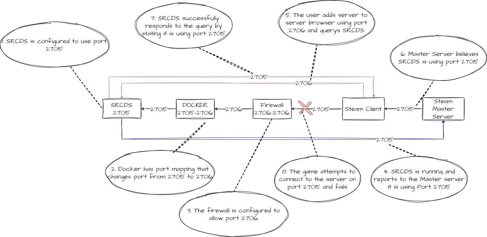
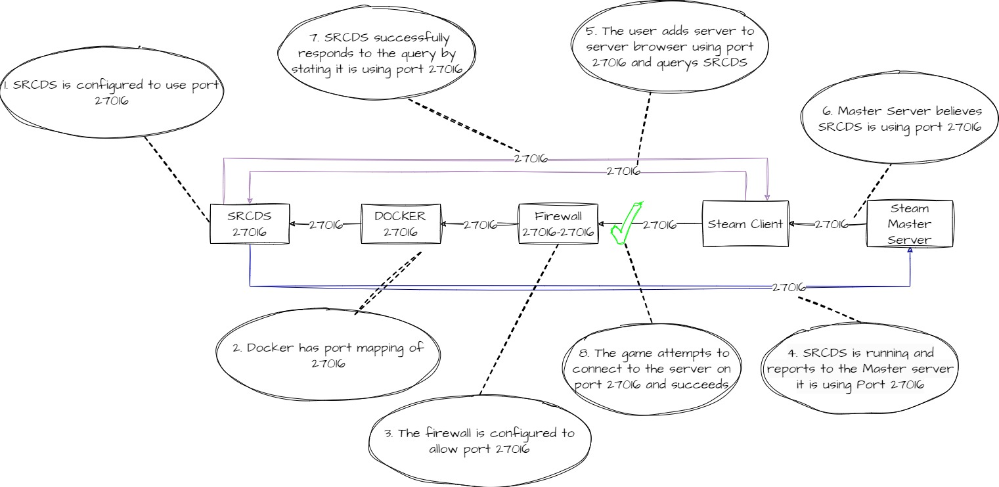

# Source Engine

## Default ports

These are common defaults for Source dedicated servers. The game, engine version and start parameters determine the actual ports; GoldSrc and Source 2 games may differ.

Direction is relative to your game server. **Inbound** traffic starts with an Internet player or administrator contacting your server. **Outbound** traffic starts with your server contacting another service. Replies travel in the opposite direction.

For the forwarding column, assume a public dedicated server behind a router with stateful NAT and outbound connections allowed. Use your configured port numbers if you changed the defaults.

| Purpose | Common default | Protocol | Direction | Forward on the router? |
| --- | --- | --- | --- | --- |
| Game and query | 27015 | UDP | **Inbound** | **Yes**, for players connecting from the Internet. |
| RCON | 27015 | TCP | **Inbound** | **Only if** administrators need direct access from the Internet. Restrict access to trusted addresses, or use a VPN. |
| Client | 27005 | UDP | **Outbound** | **No** for normal dedicated Source server hosting. Players connect to the game port above. |
| SourceTV | 27020 | UDP | **Inbound** | **Only if** you enable SourceTV for spectators connecting from the Internet. |
| Steam backend | Around 26900/26901 | UDP on older Source servers | **Outbound** | **No** for outbound Steam communication and its replies. This is not a player connection port. |

For a typical Source server offering gameplay without public RCON or SourceTV, forward its game/query port, usually **27015/UDP**. Do not forward 27005 or 26901 just because they appear in a port list. Check the game's documentation for any extra incoming services it requires.

## Steam backend port

Valve describes the [Steam port](https://partner.steamgames.com/doc/api/steam_gameserver#SteamGameServer_Init) as the local port used to communicate with Steam servers. Here, Steam servers means Valve's services on the Internet. The running game server makes this connection itself; SteamCMD is not involved. Local means the socket is on your machine, not that it is an internal SteamCMD-to-game-server connection. It is separate from the game port and query port. A [Game Server Login Token](../steamcmd/gslt.md) authenticates the server; it does not assign a universal GSLT port.

Older Source games commonly use ports around 26900/26901, and some select another port when one is occupied. Supported launch options and the relationship between a requested port and the bound port vary by game. Check the game's supported start parameters before changing this port. A LinuxGSM variable only changes the binding if the game's launch command or config uses it.

LinuxGSM can report a configured Steam port and may detect one from a running Source server's sockets. If the port is unknown, the Steam row may be absent. This alone does not show that Steam login has failed.

## Firewall direction and port forwarding

Port forwarding lets a new connection from the Internet reach a service behind your router. Replies to a connection your server opened are different: a stateful router/firewall tracks that connection and normally lets its replies back without a manual forwarding rule.

Allow incoming game/query traffic through the server firewall and router. Add incoming rules for SourceTV or RCON only when you provide those services. A server with a public IP, such as many VPSs, does not need router port forwarding, but its host firewall and provider firewall/security group must still allow the required incoming traffic.

For Docker bridge networking, publish the incoming service ports to the host using the matching protocol, then forward them to that host if it is behind a router. Outbound SteamCMD and Steam connections do not need Docker ports published just to receive replies.

If outbound traffic is restricted, allow the required Steam destinations and established reply traffic. Adding an inbound 26901 forward will not fix a blocked outbound connection. Check the console for the actual Steam login error and use the game's networking requirements before adding rules.

The `LISTEN` column in `./gameserver details` reports socket binding. It does not test your firewall, router forwarding, or whether an Internet client can reach the server.

SteamCMD login/download connections have separate requirements; see [SteamCMD network ports](../steamcmd/README.md#network-ports) and Valve's [Required Ports for Steam](https://help.steampowered.com/en/faqs/view/2EA8-4D75-DA21-31EB).

## Static Port Mapping (NAT/Docker)

The port that is configured in the start parameters _must_ be the port that is exposed to the Internet. This is because the game server reports the port that it is configured in start parameters to use to the master server. If this does not match the game client will not be able to connect to the server.                                                                                                                                                                                                                                                                                                                                                                                                                                                                                                                                                                                      &#x20;

<figure><figcaption>
Changing port using Docker or firewall
</figcaption></figure>

<figure><figcaption>
Changing port using the start parameters
</figcaption></figure>

