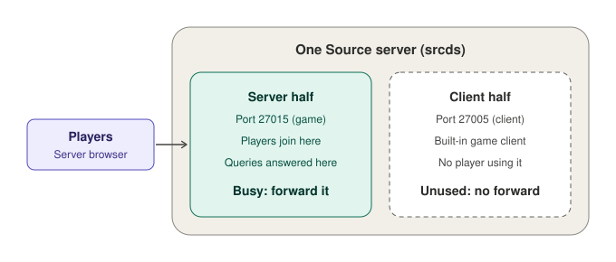
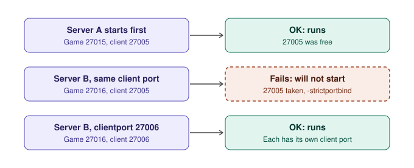
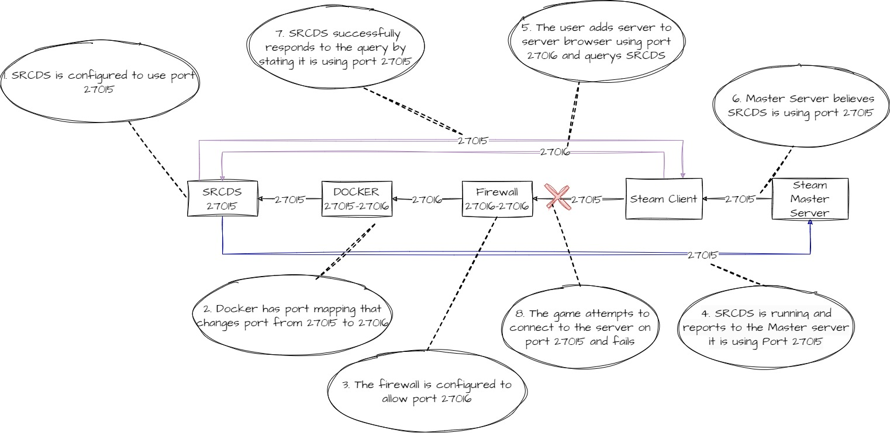
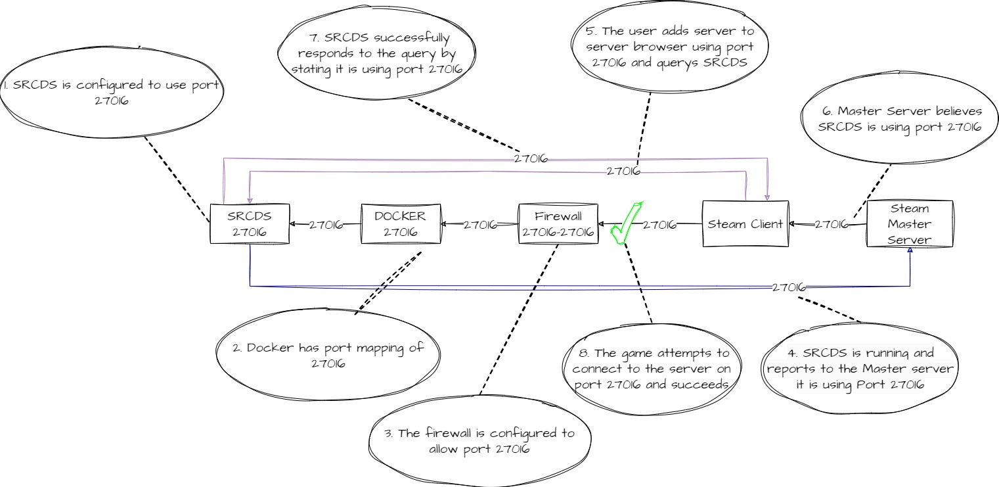

# Source Engine

## Default ports

For a typical public Source dedicated server, allow **27015/UDP inbound** for players and server browser queries. If the server is behind a router, forward that port to the server. Add incoming ports for RCON or SourceTV only when you use those services over the Internet.

The table shows common Source defaults. Use your configured ports if they differ, and check the game's requirements for additional services. GoldSrc and Source 2 games may differ.

Direction is relative to your server: **Inbound** starts with another machine contacting your server; **Outbound** starts with your server contacting another service. Replies travel in the opposite direction. **Unused** means the server opens the port but never sends or receives on it.

| Purpose | Default port | Protocol | Direction | Forward on the router? |
| --- | --- | --- | --- | --- |
| Game and query | 27015 | UDP | **Inbound** | **Yes**, for Internet players and queries. |
| RCON | 27015 | TCP | **Inbound** | **Only if** administrators need direct Internet access. Restrict it to trusted addresses. |
| SourceTV | 27020 | UDP | **Inbound** | **Only if** Internet spectators use SourceTV. |
| Client | 27005 | UDP | **Unused** | **No**, but each server on the same host needs its own. See [Client port](#client-port). |
| Steam backend | 26900/26901 on older Source games; varies | UDP | **Outbound** | **No** for outgoing Steam connections and their replies. |

The forwarding guidance assumes a router with stateful NAT and outbound connections allowed. The router tracks outbound connections and lets their replies back without a separate port forward.

## Firewall and router setup

* **Server firewall:** allow the inbound game/query port and any optional incoming services you use. Allow required outbound Steam traffic and its replies.
* **Router/NAT:** forward only the required incoming services to the server. Outbound Steam connections and their replies do not need manual forwarding rules.
* **Public-IP server/VPS:** router forwarding is not needed when the server has a directly reachable public IP. The server firewall and provider firewall/security group must still allow the required incoming traffic.
* **Docker bridge networking:** publish the required incoming ports to the host with the correct TCP/UDP protocol. If the host is behind a router, forward those ports to the host as well. Outbound connections do not need Docker ports published to receive replies.

Use `./gameserver details` to check port settings. Its `LISTEN` column reports socket binding; it does not test firewall rules, router forwarding or Internet reachability. If Steam login fails, check the game console and outbound connectivity rather than adding an inbound Steam-port forward.

## Client port

The client port is the one that confuses most people, so here is what it is and why LinuxGSM sets it.

### What it is

The Source engine is a single program that contains both the game you play and the server you host. When you play a Source game, the client half of the engine uses the client port (27005 by default) to talk to servers. A dedicated server runs the same engine, so it opens the client port as well, even though no player is sitting at it.

<figure><figcaption><p>Players and the server browser only ever use the game port</p></figcaption></figure>

On a dedicated server the client port is unused. Players, server browser queries, RCON and the Steam master server do not use it, and nothing is sent or received on it. It does **not** need to be opened in a firewall or forwarded on a router.

### Why it still matters

Even an unused port takes up its number, and only one program can use a port number at a time. If you run more than one Source server on the same host, each server needs its own client port, as well as its own game and SourceTV ports.

LinuxGSM starts Source servers with `-strictportbind`, which tells the server to stop rather than quietly pick a different port. So if a second server finds 27005 already taken, it will not start, even when its game port is different. The console log shows:

```
FATAL ERROR: ERROR: Port 27005 was unavailable - quitting due to "-strictportbind" command-line flag!
```

<figure><figcaption><p>Two servers on one host need different client ports</p></figcaption></figure>

To fix it, give each server its own client port in its [instance config](../configuration/linuxgsm-config.md):

```
clientport="27006"
```

See [Ports](ports.md) for ways to plan ports across several servers.


Servers that each run in their own Docker container have their own set of ports, so they cannot clash on the client port.


### Games that ignore it

A few games handle the client port differently. Setting `clientport` has no effect on them:

* **Garry's Mod** picks a random client port each time it starts.
* **Left 4 Dead**, **Left 4 Dead 2** and **Nuclear Dawn** do not open a client port at all.
* **GoldSrc** servers (Half-Life 1 based games) do not open a client port either.

## Static Port Mapping (NAT/Docker)

Source servers advertise their configured game port to Steam's server browser. Keep the Internet-facing game port the same as the game's configured port so players can connect to the advertised address.

For example, if the game uses 27015/UDP, publish 27015/UDP from Docker and forward 27015/UDP on the router to that host. To use 27016/UDP instead, change the game's start parameters to 27016 and use that port in the Docker mapping and router rule.

<figure><figcaption><p>Changing port using Docker or firewall</p></figcaption></figure>


<figure><figcaption><p>Changing port using the start parameters</p></figcaption></figure>

