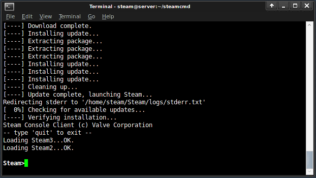

# SteamCMD

.png>)

SteamCMD is Valve's command-line client for downloading and updating applications distributed through Steam. LinuxGSM uses it for game servers that provide their files through Steam. Each application has an AppID; the dedicated server AppID can differ from the game's client AppID. See Valve's [Dedicated Servers List](https://developer.valvesoftware.com/wiki/Dedicated_Servers_List) or [SteamDB](https://steamdb.info/search/?a=app&q=server).


SteamCMD normally downloads files for the host operating system. It can also request files for another platform. LinuxGSM selects the required platform for supported servers, including games that need Windows game data alongside a Linux server executable.




## Network ports

SteamCMD connects to Valve over the Internet to log in and download or update game files. It needs **outbound access**, not incoming port forwarding.

Valve lists these destination ports for Steam login and downloads:

| Destination ports | Protocol | Direction |
| --- | --- | --- |
| 80 and 443 | TCP | **Outbound** from your machine to Valve/content servers |
| 27015-27050 | TCP and UDP | **Outbound** from your machine to Steam services |

If your firewall already allows outbound connections and their replies, no extra inbound rule or router port forward is needed for SteamCMD. If outbound traffic is restricted, allow the destination ports above and reply traffic. These are ports on the remote services, not ports to forward into your server. See Valve's [Required Ports for Steam](https://help.steampowered.com/en/faqs/view/2EA8-4D75-DA21-31EB) for its current requirements.

The running game server has separate networking requirements. Players must be able to reach its incoming game/query ports. See [Source engine ports](../networking/source-engine.md) or the [general ports guide](../networking/ports.md) for other games.

## SteamCMD Login

The game's Steam distribution determines whether SteamCMD can log in anonymously or needs an account.

### Anonymous Login

For servers available anonymously, keep LinuxGSM's default Steam login settings. No Steam account details are required.

### Steam User Login

Some servers require a Steam account, and some require that account to own the game. Use a [dedicated Steam account](https://store.steampowered.com/join/) for server administration.

When LinuxGSM reports that a Steam login is required, set the credentials in the [LinuxGSM config](../configuration/linuxgsm-config.md#secret-configs). Use `secrets-common.cfg` for shared settings or `secrets-<gameserver>.cfg` for a particular instance, in `lgsm/config-lgsm/<gameserver>/`.

```bash
steamuser="username"
steampass='password'
```

Keep the password in single quotes so characters such as `$` are not expanded. Config values use Bash quoting rules.

#### No subscription

`ERROR! Failed to install app '<appid>' (No subscription)` means the Steam login does not have the entitlement needed for the requested application. Check the AppID, the account being used, and whether that server supports anonymous downloads. For a paid game that requires ownership, the account must own the required game. For a free game, the account may need to claim its licence through the Steam store.

Some game servers also need a Steam login for [Workshop downloads](workshop.md#steam-account-requirements), even when the server itself downloads anonymously.


Use a dedicated Steam account for the game server. Credentials saved in LinuxGSM config files are stored in plain text. Restrict access to those files and to the server's Steam authentication cache.


See the [SteamCMD server data](https://linuxgsm.com/data/steamcmd) for game-specific login requirements.

### Plain Text Passwords

Secret config files separate credentials from general settings; their contents are not encrypted. Limit read access to the server account and administrators, and exclude these files from public repositories and shared backups.

LinuxGSM passes configured credentials to SteamCMD when it logs in. Command-line arguments, diagnostic output or debug logs can expose sensitive values depending on the system and logging mode. Check logs before sharing them for support.

## Steam Guard


Steam Guard adds verification to Steam account logins. A new or unauthorised login can require an emailed code or confirmation through the Steam Mobile app. See [Steam Support](https://help.steampowered.com/en/faqs/view/06B0-26E6-2CF8-254C) for account settings.

### Authentication Methods for SteamCMD

| Method | Verification | LinuxGSM automation |
| --- | --- | --- |
| Username and password without Steam Guard | Account credentials | Can run unattended, with less account protection. |
| Steam Guard by email | Email code when Steam requires authorisation | Suitable after authorisation, while the saved login remains valid. |
| Steam Guard Mobile Authenticator | Mobile code or approval when requested | Not recommended for unattended game-server updates. Any login requiring a fresh code or approval needs an administrator present. |

### Using Steam Guard with LinuxGSM

Use email-based Steam Guard for a server account that needs unattended LinuxGSM updates. Complete the initial authorisation interactively as the same Linux user that runs the game server, then verify that a subsequent update can log in without prompting.

Authentication that requires a fresh mobile code or approval for each login is unsuitable for automatic updates and should not be used for unattended server operation.

SteamCMD can cache a successful login for later runs. The cache belongs to that Linux user's Steam installation. It must remain available between updates, including when running in a container. Moving to another user or installation, removing the cache, or Steam requiring reauthorisation can cause another prompt. Complete the required verification interactively before relying on scheduled updates again.
